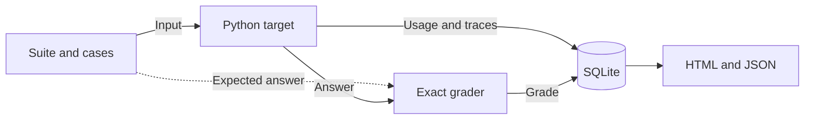
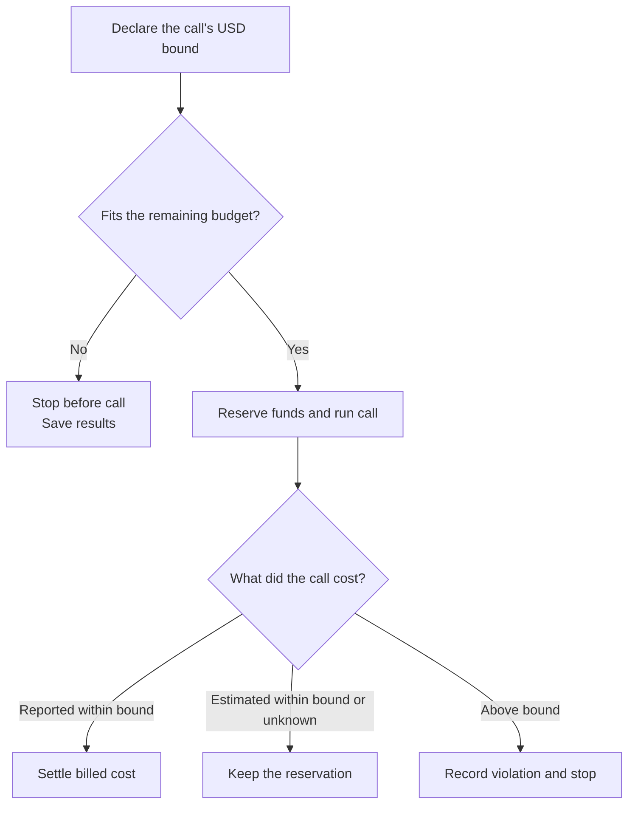
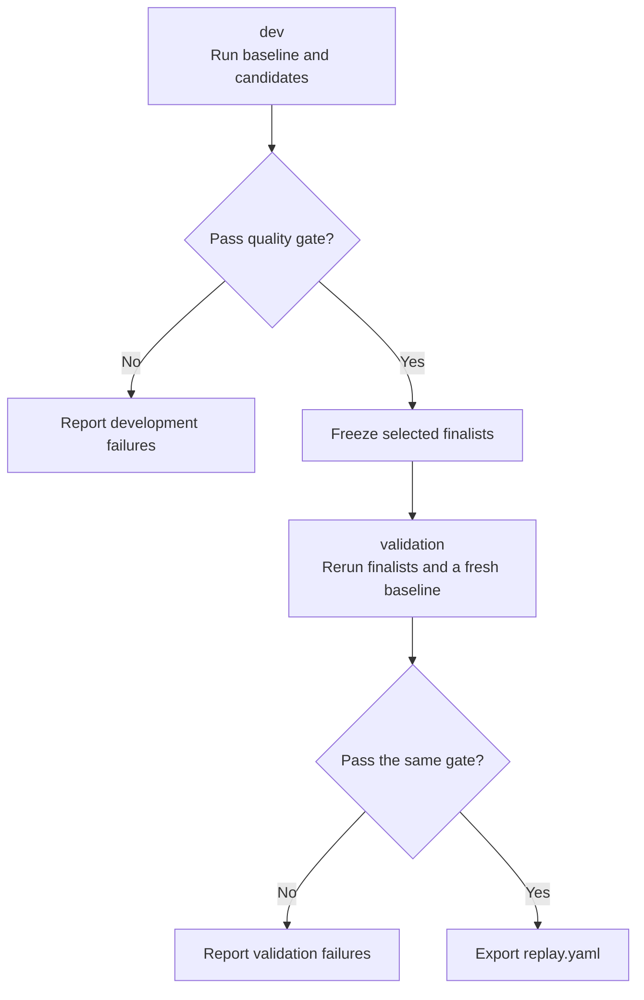

# TokenBench

TokenBench runs baselines for Python applications and OpenAI-compatible Chat Completions endpoints, plus deterministic policy experiments on targets with hooks. It grades each result by exact match and records attempts, model calls, usage, and policy events in SQLite. The bundled toy RAG suite runs end to end against frozen records and a deterministic fixture model.



## Install and run the offline demo

TokenBench requires Python 3.11 or later. Install the dependencies with `uv sync` from the project root. The initial setup fetches the locked dependencies. Running the demo requires zero API keys and zero network access.

```sh
uv sync
uv run tokenbench doctor
uv run tokenbench init --path ./tokenbench-demo
uv run tokenbench baseline --suite ./tokenbench-demo/suite.yaml --dry-run
uv run tokenbench baseline --suite ./tokenbench-demo/suite.yaml --out ./runs/baseline
```

The demo should report 36 passing trials and 36 attempts. Open `runs/baseline/summary.html` in a browser, or read `runs/baseline/summary.json`.

If your checkout is on exFAT, run `export UV_PROJECT_ENVIRONMENT="$HOME/.local/share/tokenbench/venv"` before `uv sync`. Keep that environment setting when running the CLI so `uv` can use a filesystem that supports symlinks.

## CLI reference

| Command | Behavior |
| --- | --- |
| `tokenbench --help` | Lists the available commands. Add `--help` after a command to show its options. |
| `tokenbench doctor` | Reports the Python and SQLite versions and performs an in-memory SQLite write. |
| `tokenbench init --path DIRECTORY` | Copies the offline Toy RAG and tool-screening suites, task cases, price snapshot, and example experiments to the requested directory. Existing demo files cause the command to stop before copying. |
| `tokenbench baseline --suite FILE --dry-run` | Validates YAML, task records, pricing, and the configured target. Python targets import their configured module. Chat targets validate message inputs and the configured credential. It runs zero trials and writes zero output files. |
| `tokenbench baseline --suite FILE --out DIRECTORY [--budget-usd USD]` | Runs the selected cases sequentially. The optional USD budget uses the target's per-call bounds and preserves results when it stops a run. `--out` must point to a new or empty directory. A completed benchmark exits successfully regardless of the measured pass rate. Invalid configuration and filesystem errors produce a nonzero exit status. |
| `tokenbench run --experiment FILE --dry-run` | Validates the experiment, suite, Python entrypoint, policy configuration, and any validation split or budget requirements. It runs zero trials and writes zero output files. |
| `tokenbench run --experiment FILE [--out DIRECTORY]` | Runs named candidates, single-policy and pairwise screening, or optional Optuna search. It writes comparison and Pareto reports, including completed results when a configured budget stops the run. Output defaults to `runs/<experiment-id>` and must point to a new or empty directory. |

Run the commands with `uv run` from the project root, or directly in the installed environment.

## Connect a Python application

Install the target application in the same Python environment as TokenBench. Set `entrypoint` to an importable `package.module:function`. The callable may be synchronous or asynchronous. It receives the case's `input` object and a `TraceSink` and returns a JSON-compatible answer. The grader compares object keys and values recursively, ignores object key ordering, and preserves array ordering and JSON types.

For example, wrap an existing lookup workflow with an importable `my_app.benchmark` module.

```python
from pydantic import JsonValue

from my_app.workflow import lookup
from tokenbench.trace import TraceSink


def run(task_input: dict[str, JsonValue], _trace: TraceSink) -> JsonValue:
    query = task_input["query"]
    if not isinstance(query, str):
        raise ValueError("query must be a string")
    return lookup(query)
```

For usage accounting, pass the trace sink into the workflow and wrap each underlying model call. This gives failed calls and internal retries their own traces. Use the sink on the callable's thread and finish instrumented work before returning. `call.report_usage(ProviderUsage(...))` accepts normalized provider data. Import `ProviderUsage` from `tokenbench.pricing`. Pass `input_tokens`, `output_tokens`, and, when available, `cached_input_tokens`, `reasoning_tokens`, or `cost_usd`. Counts and cost can be omitted when unknown. Use `call.estimate_usage(input_tokens, output_tokens)` for local tokenizer or heuristic counts. `trace.model_call(provider=..., model=...)` can override the suite's identifiers for that call.

```python
with trace.model_call() as call:
    result = model.generate(prompt)
    call.report_usage(
        ProviderUsage(
            input_tokens=result.prompt_tokens,
            output_tokens=result.completion_tokens,
        )
    )
```

An uninstrumented callable can still run and be graded. Its attempts have no model spans and the corresponding token and cost totals are incomplete. Use trusted targets and configuration. Imports and execution use the current process's permissions. The runner passes case inputs to the target and keeps expected answers in the grader. Ledger and report data include identifiers, counts, timing and exception types. Prompt content, completions, expected answers, and exception messages are excluded.

Save the suite below as `suite.yaml`. File locations are relative to that YAML file. Omit `split` to include all cases, or use `dev`, `validation`, or `test`. Repetitions default to 1 and retries to 0. A retry follows a target or output validation exception. A completed but incorrect answer is graded once per repetition.

```yaml
schema_version: 1
suite_id: inventory-lookup
target:
  adapter: python
  entrypoint: my_app.benchmark:run
  provider: local
  model: inventory-v1
cases: cases.jsonl
split: dev
repetitions: 1
max_retries: 1
```

Each line in `cases.jsonl` holds one task with a unique `task_id`. This example expects the workflow to return the object shown in `expected`.

```json
{"schema_version":1,"task_id":"oak-code","input":{"query":"What is Oak Point's catalog code?"},"task_type":"lookup","split":"dev","grader_spec":{"kind":"exact","expected":{"answer":"OP-201"}}}
```

Optionally add `price_snapshot: prices.json` to the suite to estimate USD cost from frozen per-million input and output rates. The bundled `prices.json` shows the v1 format. Provider-reported cost and token counts take precedence. Cache-read and reasoning counts are included within input and output totals respectively. A snapshot can set `cached_input_usd_per_million` to price cached reads separately. When a call reports cached reads and has neither a provider charge nor a matching cached rate, its cost is unknown.

The [Hypogen example](examples/hypogen/README.md) meters a research app's model requests with an in-process mock and compares exact evidence deduplication and field projection on six cases.

## Connect an OpenAI-compatible endpoint

The adapter sends one non-streaming text request to `POST {base_url}/chat/completions`. It grades the single returned text on a normal `stop` completion. Configure `base_url` through the API prefix, such as `http://127.0.0.1:8001/v1`. For authenticated services, set `api_key_env` to an environment variable name and put the bearer token in that variable. The compiler rejects policies that require internal target hooks. [Chat Completions API reference](https://developers.openai.com/api/reference/resources/chat/subresources/completions/methods/create)

```yaml
schema_version: 1
suite_id: chat-fixture
execution: local_fixture
target:
  adapter: openai_compatible
  provider: loopback
  model: fixture-chat
  base_url: http://127.0.0.1:8001/v1
  timeout_seconds: 2
  max_completion_tokens: 64
  max_cost_usd: '0'
cases: chat-cases.jsonl
max_retries: 2
```

```json
{"task_id":"test-chat","task_type":"chat","input":{"messages":[{"role":"user","content":"Return the fixed answer."}]},"grader_spec":{"kind":"exact","expected":"fixture answer"}}
```

```sh
uv run tokenbench baseline --suite ./chat-suite.yaml --budget-usd 0 --dry-run
uv run tokenbench baseline --suite ./chat-suite.yaml --budget-usd 0 --out ./runs/chat-baseline
uv run pytest tests/test_openai_compatible.py
```

The example suite assumes a free local endpoint. The last command starts loopback mock servers itself and covers timeouts, retries, usage accounting, and budget admission. `timeout_seconds` is the per-request deadline. Timeouts, transport failures, HTTP 408, HTTP 429, and server errors use the suite's retry limit. Rejected requests and invalid or truncated completions produce terminal failures. Each attempted HTTP call gets its own ledger row. [HTTPX timeout reference](https://www.python-httpx.org/advanced/timeouts/)

The adapter normalizes `prompt_tokens`, `completion_tokens`, cached reads, and reasoning tokens. Provider charges can arrive as `usage.cost_usd` or `usage.cost` in USD. A timed-out or otherwise unreported attempt leaves its usage unknown, and the summary preserves known subtotals separately. With a USD budget, `target.max_cost_usd` is the reservation per HTTP attempt, including retries, and must bound the actual charge. [OpenRouter usage accounting example](https://openrouter.ai/blog/insights/cost-vs-quality-tradeoff-framework-for-agent-models/)

## Run a policy experiment

```sh
uv run tokenbench run --experiment ./tokenbench-demo/experiment.yaml --dry-run
uv run tokenbench run --experiment ./tokenbench-demo/experiment.yaml --out ./runs/topk
```

Use `init` with a fresh directory if your demo predates `experiment.yaml`. The bundled experiment selects the first two or first one of the three ranked documents. The frozen fixture passes 36/36 cases in all three configurations and emits 1,776 estimated total tokens for baseline, 1,344 for top-2, and 912 for top-1.

An experiment YAML contains `schema_version: 1`, an `experiment_id`, a `suite` path relative to the YAML, and one of `candidates`, `screening`, or `search`. It can include `budget` and `quality` settings. For manually configured experiments, each candidate has a unique `name` and an ordered `policies` list. Each policy has an `id`, optional `hook` and `enabled` fields, and typed `parameters`. Set `enabled: false` to disable a policy or use `policies: []` for a no-op candidate. This example uses the bundled suite.

```yaml
schema_version: 1
experiment_id: toy-rag-single
suite: suite.yaml
candidates:
  - name: topk-2
    policies:
      - id: rag.topk
        parameters: {k: 2}
```

See all seven implemented policy IDs, parameters, regression examples, and researched future methods in the [strategy catalog](docs/strategy-catalog.md).

### Screen single policies and pairs

```sh
uv run tokenbench run --experiment ./tokenbench-demo/screening.yaml --dry-run
uv run tokenbench run --experiment ./tokenbench-demo/screening.yaml --out ./runs/tool-screening
```

The bundled `screening.yaml` uses three factors. A factor has a unique `name` and one enabled `policy`. The runner executes an unmodified baseline, each factor on its own, and each compatible two-factor combination. For policies sharing a hook, their order follows the order in `screening`. The report records incompatible pairs and the compiler reason. Screening executes only cases labeled `dev`. A suite with no explicit split defaults to `dev` in this mode. A suite that explicitly selects `validation` or `test` is rejected.

The bundled tool fixture passes all four `dev` cases at 176 estimated tokens. Field projection and deduplication individually save 96 and 80 tokens. Together they save 128 because some savings overlap. The pair passes two cases, with regressions on the unit lookup and backup verification. The fixture has zero billable cost.

The pairwise report computes **interaction = observed pair change − first single change − second single change**, with all changes measured against the same baseline. A positive token or USD interaction means the pair uses more than the additive estimate. A positive pass interaction means the pair passes more trials than the additive estimate. Unsupported or failed comparisons and unavailable measurements have unknown interaction values. The HTML and JSON reports list the individual regressed trials.

### Apply budgets and validate finalists

```sh
uv run tokenbench run --experiment ./tokenbench-demo/quality-screening.yaml --dry-run
uv run tokenbench run --experiment ./tokenbench-demo/quality-screening.yaml
```

The example adds the following settings to the screening experiment.

```yaml
budget:
  max_trials: 6
  max_seconds: 30
  max_usd: '0'
quality:
  min_success_rate: '1'
  max_absolute_drop: '0'
  critical_task_ids: [south-unit, west-validation-unit]
  validation_candidates: 1
```

- `max_trials` caps candidate configurations started in the search phase. Baselines and the separately bounded validation finalists use the shared time and USD limits.
- `max_seconds` covers evaluation across both splits. Async targets can be cancelled at await points. The runner uses an available POSIX timer for blocking synchronous calls on the main thread. In other environments, and for native code that delays signal handling, it checks the deadline at target and trace boundaries. The runner finalizes the ledger and writes reports after stopping.
- `max_usd` requires `target.budgeted_model_calls: true` and a conservative `max_cost_usd` on every instrumented call. Set a real per-call upper bound from the provider tariff and enforced input and output limits. Include any paid work and retries in that bound or give them their own reservations. The runner blocks a call before execution if its reservation would exceed the available budget. Provider-reported costs release unused reservations. Estimated or unknown costs retain their reservation. If observed cost exceeds a declared bound, the runner stops and reports the violation. This cap relies on the target instrumenting its billable work and supplying valid bounds. The offline fixtures declare a zero bound.



For example, a target with a conservative upper bound of USD 0.002 per request can use `with trace.model_call(max_cost_usd=Decimal("0.002")) as call:`. The amount and actual usage stay auditable in SQLite. Reaching a budget records a partial experiment and preserves completed results. Partial candidates have no baseline deltas or Pareto eligibility.

`quality` filters on `dev` using the minimum absolute success rate, maximum drop from the paired baseline, and newly failed repetitions of any listed critical task. Both rates are fractions from 0 to 1. The defaults are a minimum success rate of 0 and no allowed drop. Critical tasks may belong to either `dev` or `validation`. The runner orders passing `dev` candidates by known cost, then known tokens, higher success, and name, and freezes that selection before validation. It reruns the selected configurations and a fresh baseline on the same suite's `validation` split and applies the same gate there. The `test` split is reserved for a separate final evaluation. The offline example validates the boilerplate filter on eight independent tasks and records the quality failures of more aggressive candidates.



### Interpret confidence intervals and replay confirmed configurations

`comparison.json` and `comparison.html` show two-sided 95% paired percentile bootstrap intervals. Each resample draws task IDs with replacement and keeps each task's baseline and candidate repetitions together. The reported deltas are candidate minus baseline for success rate, mean tokens per trial, and mean USD per trial. Usage includes all instrumented attempts, including retries. HTML shows success rate deltas in percentage points, and JSON stores fractions. The calculation defaults to 2,000 resamples with seed 42. Set `bootstrap: {resamples: 2000, seed: 42}` in the experiment YAML to record or change these settings. [SciPy paired bootstrap reference](https://docs.scipy.org/doc/scipy/reference/generated/scipy.stats.bootstrap.html)

Reports include the counts of paired tasks and trials. Intervals are unavailable for incomplete comparisons and comparisons with fewer than two paired tasks. Unknown token or USD measurements suppress the corresponding interval whenever a task pair is missing that metric. A small sample or uniform deltas can produce a narrow interval, so read it alongside the task count and the split. The quality gate uses the observed paired outcomes.

A completed finalist that passes independent validation gets a `replay.yaml` in its validation run directory. The file retains the exact ordered policies, quality gate, budget, and bootstrap settings. It records the source experiment hash and verifies suite, case, pricing, and available target-module fingerprints, as well as the TokenBench version and saved settings. Keep the original suite and fixtures at the referenced locations. A replay reruns the fixed configuration against fresh baselines on `dev` and `validation` using the same Python target.

```sh
uv run tokenbench run --experiment ./runs/quality-screening/validation/boilerplate/replay.yaml --dry-run
uv run tokenbench run --experiment ./runs/quality-screening/validation/boilerplate/replay.yaml --out ./runs/quality-replay
```

### Run optional Optuna search

```sh
uv sync --extra search
uv run --extra search tokenbench run --experiment ./tokenbench-demo/search.yaml
```

In `search.factors`, each factor has a `name` and one or more typed `choices` for the same policy and hook. Optuna can omit a factor or choose one parameterization of it. The listed order controls compilation. The seeded NSGA-II sampler searches the `dev` split under the required `budget.max_trials` and any time or spend bounds. Fully measured configurations that pass the configured quality gate supply four objectives to Optuna. Each unique policy configuration is run once, and the unmodified baseline is run separately. Pareto reports show measured results and tag incomplete, rejected, and unknown-cost configurations. [Optuna Study](https://optuna.readthedocs.io/en/stable/reference/generated/optuna.study.Study.html)

### Add target hooks

Declare the hooks your target invokes under `target.hooks` in the suite YAML. A Python target calls `trace.apply_context` with typed segments and uses the returned sequence to assemble its prompt or next input. For example, after ranking a set of retrieved documents, pass each document as a segment.

```python
from tokenbench.policies.models import ContextSegment

documents = trace.apply_context(
    "retrieval",
    [
        ContextSegment(
            segment_id=doc.source_id,
            kind="retrieved_doc",
            content=doc.text,
            source_ids=(doc.source_id,),
            mutable=True,
        )
        for doc in ranked_documents
    ],
)
prompt_context = [segment.content for segment in documents]
```

Use the `tool_response` hook for tool payloads and `history` for chronological history blocks. History blocks with the same `turn_id` form a complete turn. Use `trace.step()` immediately before each agent step. Segment contents are immutable by default. Mark only optional data `mutable=True`, pin cited evidence with `protected=True`, and use `exact=True` for byte-sensitive content. Instructions, the active query, code, schemas, commands, credentials, citations, and system or developer roles receive automatic protection. For projection, set `required_keys` on a structured segment to preserve additional exact fields. Use opaque IDs in `segment_id`, `source_ids`, and artifact references because the ledger stores these identifiers.

For log trimming, pass a `tool_result` segment with `format="log"`. Its JSON content must include `lines`, `diagnostic_lines` with zero-based indexes into the original lines, `exit_code`, and `artifact_ref` for the complete frozen log. Mark every known failure cause and stack-trace line as diagnostic. The runner retains explicitly marked diagnostics, recognizable error markers, and the remainder of the log after a recognizable stack start. An unclassified failed log causes a policy failure. The complete log stays at the target-provided artifact reference.

Experiments use the same suite and input order for all candidates. Reset any external target state between trials as part of the adapter. A candidate is marked `unsupported` when it declares an enabled hook that is never observed across its cases. A policy contract violation is audited as `failed`. A step cap records a failed trial with a `blocked` policy event.

## Run artifacts

- `baseline.sqlite3` stores the manifest, every started attempt, and every instrumented model call. Each attempt records its repetition, retry number, status, timestamps, and elapsed time. A process interruption can leave `running` rows for work that started and could not be finalized.
- `summary.json` contains the manifest, paired task and repetition identifiers, final-trial success totals, all attempts, and per-call usage and cost sources. Totals include failed calls and retries. A complete total is `null` when relevant observations are missing. Known subtotals and missing counts are shown separately. USD amounts are decimal strings.
- `summary.html` presents the run metadata, aggregate results, and attempt ledger as a standalone report.

An experiment creates `baseline/` and one directory per candidate with its own ledger and summaries. Independent validation runs are under `validation/`. `comparison.json` and `comparison.html` show paired outcomes, budget status, and quality decisions. `pareto.json` and `pareto.html` show success rate, total tokens, USD, and observed p95 trial latency for each split. The HTML includes three clickable scatter plots. A green ring marks a confirmed candidate, and its point opens the validation outcomes and confidence intervals. P95 uses the nearest rank on per-trial sums of attempt durations, including retries. A candidate is on the observed frontier if no eligible configuration matches or improves every objective and improves at least one. A partial experiment can still show a frontier among fully evaluated points. Missing metrics appear as `null` in JSON and exclude a point from the frontier.

The per-attempt policy audit includes changed or removed segment IDs, kept and removed references, estimated before/after context tokens, compressor overhead, and failure reasons. SQLite stores policy runtime, and the deterministic JSON includes policy IDs, version, order, and configuration hashes. Context estimates use whitespace counts for hook inputs and outputs. Step checks record their step number and leave context counts unset. End-to-end token deltas come from model call usage in the ledger.

The demo's `local_fixture` label identifies an end-to-end fixture evaluation. Its whitespace-based counts are estimates, and its zero USD rates apply only to the local fixture model. Baseline and fixed-candidate comparison artifacts omit timing and remain deterministic when the experiments complete with the same observations. Pareto reports and SQLite contain observed timing. Adaptive choices can change with measured latency. The manifest fingerprints the suite, dataset, price snapshot when present, and the callable's source module when available.

## Development checks

GitHub Actions runs these checks on Python 3.11 and 3.15 for pull requests and updates to `main`. The smoke test runs the installed CLI against the offline fixtures, verifies that a capped Optuna search preserves its completed results, and reruns its confirmed replay YAML.

```sh
uv sync --locked --extra search
uv run pytest
uv run ruff check .
uv run ruff format --check .
uv run mypy src tests scripts
uv run --extra search python scripts/ci_smoke.py
```
